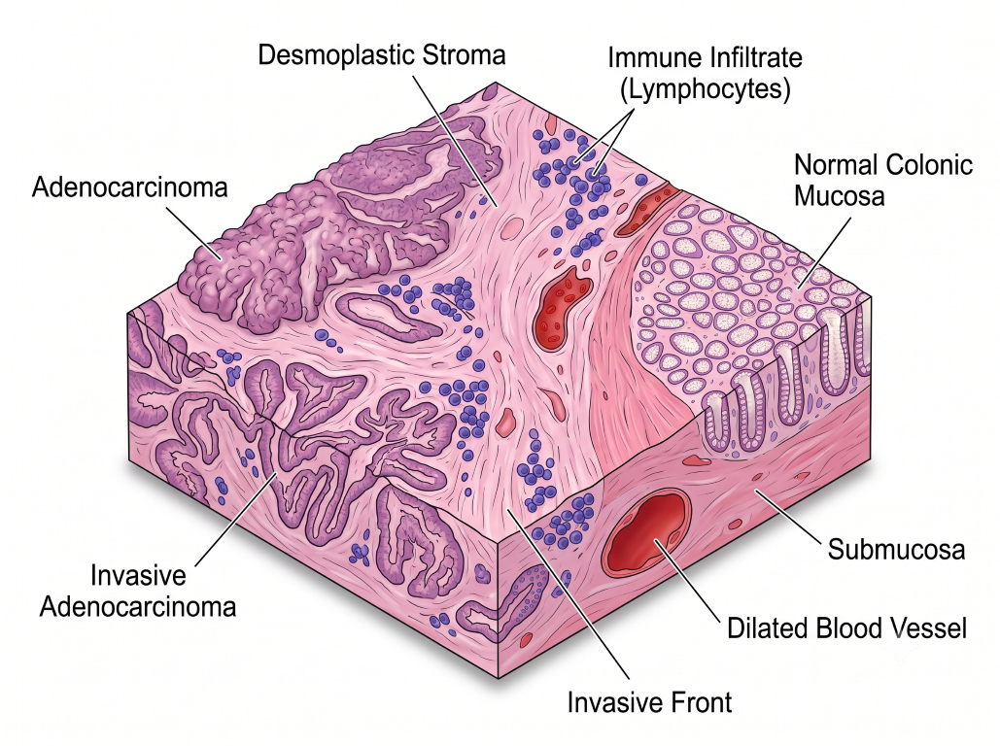

[](https://creativecommons.org/licenses/by/4.0/)
[](https://github.com/sib-swiss/intro-spatial-transcriptomics-training)
[](https://github.com/sbwiecko/intro-spatial-transcriptomics-training/discussions)

# Intro to Spatial Transcriptomics: A Wet-Lab Scientist's Study Fork

Welcome! This repository is an annotated, restructured study fork of the [SIB Swiss Institute of Bioinformatics Introduction to Spatial Transcriptomics Data Analysis Course](https://github.com/sib-swiss/intro-spatial-transcriptomics-training).

I come from a **wet-lab background** and am investing significant effort into transitioning toward computational biology. To make the learning curve manageable and fully focus on the code and biology, **I simplified the project architecture**. I removed the heavy Docker containers in favor of standalone **Jupyter Notebooks (`.ipynb`)** so you can easily clone the repo and practice the code yourself.

---

## What You Will Find in This Fork

* **Streamlined Interactive Format:** Converted from the original `.qmd` files into pure Jupyter Notebooks (`.ipynb`) (via `quarto convert`, configured to use the R kernel via `jupyter: ir` in the YAML front matter) for direct, interactive execution.
* **Wet-Lab Context & Concept Deconstruction:** Line-by-line notes translating abstract computational steps into biological meaning.
* **Troubleshooting & Technical Deep Dives:** Detailed reflections and extra research on tricky parameters, spatial Bioconductor quirks, and statistical assumptions.
* **Refactored & Annotated Code:** Code cells with additional comments explaining the *why* behind data transformations.
* **Beginner-Friendly Focus:** Written specifically for researchers without formal bioinformatics degrees who want to understand spatial transcriptomics step by step.

### Biological Model & Three Spatial Architectures Compared

Throughout the curriculum, we anchor every statistical and algorithmic concept in the histopathology of a single clinical specimen—**Human Colorectal Adenocarcinoma (Patient P2, 10x Genomics)**—spanning four distinct microenvironments:
1. **Normal colonic mucosa:** Regular crypts of Lieberkühn lined by absorptive enterocytes and mucin-rich goblet cells (`PIGR`, `CLCA1`), supported by a plasma-cell-rich lamina propria (`IGKC`, `JCHAIN`).
2. **Invasive colorectal adenocarcinoma:** Crowded, fused cribriform glands with hyperchromatic nuclei and intraluminal necrotic debris (`CEACAM5`, `MUC17`, `OLFM4`), advancing across an active **invasive front**.
3. **Desmoplastic stroma & reactive submucosa:** Dense collagenous extracellular matrix (`COL1A1`, `COL3A1`, `SPARC`), smooth muscle bands (`TAGLN`, `FLNA`), and lymphoid/macrophage immune infiltrate (`SPP1`, `DAB2`, `HLA-DRA`).
4. **Submucosal vasculature:** Congested, dilated blood vessels packed with anucleate erythrocytes (naturally transcript-sparse lumina that test the limits of spatial QC).


*3D histological schematic of the Patient P2 colorectal adenocarcinoma specimen highlighting the tissue compartments we resolve computationally across platforms.*

At each step of the pipeline, we systematically compare **three spatial data representations** of this tissue to reveal how physical capture geometry shapes biological interpretation:

| Platform & Resolution | Bioconductor Container | Matrix Backend & Serialization | Primary Plotting Engine |
| :--- | :--- | :--- | :--- |
| **Visium HD Binned (16 × 16 µm squares)** | `SpatialExperiment` (`spe`) | Out-of-memory HDF5 `DelayedMatrix` (`HDF5Array`) | `ggspavis` (`plotVisium`, `plotCoords`) |
| **Visium HD Segmented (H&E StarDist cells)** | `SpatialFeatureExperiment` (`sfe`) | Sparse `dgCMatrix` + `sf` polygons (`alabaster.sfe`) | `Voyager` (`plotSpatialFeature`, `plotImage`) |
| **10x Xenium In Situ (Subcellular imaging)** | `SpatialFeatureExperiment` (`sfe`) | 422-gene panel + 93 control probes + `sf` polygons (`alabaster.sfe`) | `Voyager` (`plotSpatialFeature`, `plotImage`) |

### Key Code & Bioconductor Optimizations in This Fork

Over the course of the notebooks, I refactored the workshop code into reproducible, memory-safe Bioconductor workflows:

* **Dual Spatial Container & Serialization Architecture:** Preserving multi-vertex `sf` cell and nuclear boundary polygons (`cellSeg`, `nucSeg`) via `alabaster.sfe::saveObject()` for `SpatialFeatureExperiment` objects, while keeping 18,000-gene × 22,000-bin `SpatialExperiment` assays out-of-memory via `HDF5Array::saveHDF5SummarizedExperiment()`.
* **Two-Tiered Spatially Aware Quality Control:** Pairing relaxed global density floors (illustrated with `scater::ggcells()` and `ggside` 2D density contours) with `SpotSweeper` local neighborhood $Z$-scores ($k = 36$) on Visium HD, and implementing 5-tier optical/morphological/contiguity filtering alongside Poisson vs. Negative Binomial overdispersion proofs on Xenium.
* **Histology-Grounded Normalization Diagnostics:** Separating observation-level library-size normalization (`scuttle::logNormCounts()`) from gene-level $Z$-score scaling, and empirically demonstrating why local spatial smoothing ($k$-NN / `SpaNorm`) induces partial-volume blurring across sharp 10–25 µm epithelial–stromal interfaces.
* **HVGs vs. SVGs & Dual-Regime Spatio-Molecular Embeddings (`BANKSY`):** Contrasting non-spatial Poisson variance modeling (`scran::modelGeneVarByPoisson()` — and full-panel retention calibrated against negative controls in Xenium) with spatial autocorrelation (Moran's $I$ via `Voyager`/`spdep`) and Gaussian Process likelihood-ratio testing (`nnSVG`), and comparing standard PCA/UMAP against neighborhood-augmented `BANKSY` embeddings across cell-typing ($\lambda = 0.2$) and tissue-domain ($\lambda = 0.8$, $k_{\text{geom}} = 20$) regimes.
* **Defensive S4 Indexing & Clean Memory Footprints:** Using strict Bioconductor accessors (`counts()`, `logcounts()`, `colData()`, `rowData()`, `spatialCoords()`, `colGeometries()`) and double-bracket extraction (`[[`) with systematic end-of-notebook sequential 2D pruning and garbage collection.

---

## Curriculum Roadmap & Module Index

### Companion Theoretical Study Notes (`assets/notes/`)

* [`01-introduction_spatial_transcriptomics.md`](assets/notes/01-introduction_spatial_transcriptomics.md) — Sequencing-based vs. imaging-based SRT, resolution trade-offs, and the spatial analytical paradigm.
* [`02-segmentation_spatial_transcriptomics.md`](assets/notes/02-segmentation_spatial_transcriptomics.md) — Image and transcript-assisted segmentation (`StarDist`, `Baysor`, `Proseg`, `Segger`), deconvolution (`RCTD`), and spillover purification (`ResolVI`, `SPLIT`).
* [`03-preprocessing_data_structures.md`](assets/notes/03-preprocessing_data_structures.md) — Space Ranger & Xenium Onboard Analysis outputs and the `SCE` → `SPE` → `SFE` Bioconductor class hierarchy.
* [`04-spatial_transcriptomics_QC_sequencing-based.md`](assets/notes/04-spatial_transcriptomics_QC_sequencing-based.md) — Global vs. local spatial QC (`SpotSweeper`) on sequencing-based arrays.
* [`05-normalization.md`](assets/notes/05-normalization.md) — Size-factor log-normalization (`logcounts`), gene-level $Z$-score scaling rules, and spatially aware normalization trade-offs (`SpaNorm`).
* [`06-intermediate_processing.md`](assets/notes/06-intermediate_processing.md) — Feature selection (`HVGs` vs. `SVGs` via Moran's $I$ & `nnSVG`), standard PCA/UMAP, and neighborhood-augmented `BANKSY` embeddings.
* [`07-clustering.md`](assets/notes/07-clustering.md) — Cell-type clustering vs. spatial domain identification (`HMRF`, `BayesSpace`, `STAGATE`, `CellCharter`, `BANKSY`), spatial coherence metrics (`ARI`, neighbor purity), and marker/SVG discovery (`scran::findMarkers()`, `DESpace`).

### Hands-On Jupyter Notebooks (`notebooks/`)

| Module | Notebook | Spatial Architecture | Core Concepts & Outputs |
| :---: | :--- | :--- | :--- |
| **00** | [`00-assembling_spatial_transcriptomics_datasets.ipynb`](notebooks/00-assembling_spatial_transcriptomics_datasets.ipynb) | Visium HD & Xenium | Cropping whole-slide datasets to a ~2.5 × 2.4 mm CRC region of interest (ROI). |
| **01** | [`01-data_ingestion_SpatialExperiment_object.ipynb`](notebooks/01-data_ingestion_SpatialExperiment_object.ipynb) | Visium HD 16-µm Binned (`spe`) | `VisiumIO` ingestion, HDF5 `DelayedMatrix` assays, scale factors, and `ggspavis` coordinate mapping (`18,085 × 21,966`). |
| **02** | [`02-data_ingestion_SpatialFeatureExperiment_object.ipynb`](notebooks/02-data_ingestion_SpatialFeatureExperiment_object.ipynb) | Xenium In Situ (`sfe`) | `readXenium` ingestion, `sf` polygons (`cellSeg`, `nucSeg`), control probes, and `Voyager` micron plotting (`541 × 52,569`). |
| **03** | [`03-data_ingestion_VisiumHD_segmented.ipynb`](notebooks/03-data_ingestion_VisiumHD_segmented.ipynb) | Visium HD Segmented (`sfe`) | Space Ranger v4+ StarDist polygons, nuclear vs. cytoplasmic expansion ratios, and ROI alignment (`18,132 × 34,874`). |
| **04** | [`04-quality_control_VisiumHD_segmented.ipynb`](notebooks/04-quality_control_VisiumHD_segmented.ipynb) | Visium HD Segmented (`sfe`) | Two-tiered QC (relaxed global floor + `SpotSweeper` local $Z$-scores) and sequential 2D pruning (`18,049 × 33,709`, 96.7% kept). |
| **05** | [`05-quality_control_VisiumHD_binned.ipynb`](notebooks/05-quality_control_VisiumHD_binned.ipynb) | Visium HD 16-µm Binned (`spe`) | Grid averaging effects on mitochondrial spikes, two-tiered `SpotSweeper` QC on 16-µm bins (`18,027 × 21,278`, 96.9% kept). |
| **06** | [`06-quality_control_Xenium_imaging.ipynb`](notebooks/06-quality_control_Xenium_imaging.ipynb) | Xenium In Situ (`sfe`) | 5-tier optical/morphological/contiguity QC (`515 × 47,671`, 90.7% kept) and Poisson vs. Negative Binomial variance proofs. |
| **07** | [`07-normalization_VisiumHD_segmented.ipynb`](notebooks/07-normalization_VisiumHD_segmented.ipynb) | Visium HD Segmented (`sfe`) | Library size factors (`logNormCounts`), $Z$-score scaling, and $k = 36$ spatial smoothing distortion across tumor borders. |
| **08** | [`08-normalization_VisiumHD_binned.ipynb`](notebooks/08-normalization_VisiumHD_binned.ipynb) | Visium HD 16-µm Binned (`spe`) | Out-of-memory `DelayedMatrix` normalization, bin cellularity vs. cell volume distributions, and partial-volume effects. |
| **09** | [`09-normalization_Xenium_imaging.ipynb`](notebooks/09-normalization_Xenium_imaging.ipynb) | Xenium In Situ (`sfe`) | Targeted 422-gene panel composition bias, single-cell size factor concordance, and feature standardization. |
| **10** | [`10-feature_selection_dimensionality_reduction_VisiumHD_segmented.ipynb`](notebooks/10-feature_selection_dimensionality_reduction_VisiumHD_segmented.ipynb) | Visium HD Segmented (`sfe`) | Poisson HVGs, `Voyager` Moran's $I$ & `nnSVG`, standard PCA/UMAP vs. `BANKSY` spatial PCA/UMAP ($\lambda = 0.8$). |
| **11** | [`11-feature_selection_dimensionality_reduction_VisiumHD_binned.ipynb`](notebooks/11-feature_selection_dimensionality_reduction_VisiumHD_binned.ipynb) | Visium HD 16-µm Binned (`spe`) | Stromal HVG rank reversal (`COL3A1` > `IGKC`), `spdep` Moran's $I$ & `nnSVG`, and 3-lobed `BANKSY` domain separation. |
| **12** | [`12-feature_selection_dimensionality_reduction_Xenium_imaging.ipynb`](notebooks/12-feature_selection_dimensionality_reduction_Xenium_imaging.ipynb) | Xenium In Situ (`sfe`) | Full 422-gene retention + 93 control probes anchored at 0, full-panel Moran's $I$ & `nnSVG`, and dual-regime `BANKSY` ($\lambda = 0.2$ vs. $0.8$, 3-way UMAP). |
| **13+** | *Upcoming: Clustering & Domains* | Segmented, Binned & Xenium | Baseline non-spatial SNN-Leiden, `BANKSY` clustering ($\lambda = 0.2$ cell types vs. $\lambda = 0.8$ domains), `BayesSpace` Potts-model grids (`13`+), neighbor purity, and `findMarkers` / `DESpace` (starting with [`13-clustering_VisiumHD_segmented.ipynb`](notebooks/13-clustering_VisiumHD_segmented.ipynb) in progress). |
| **14+** | *Upcoming: Annotation & Spatial Stats* | Multi-Platform | Reference-based cell-type annotation (`RCTD`), spatial neighborhood statistics, and differential spatial pattern testing. |

---

## Learning Objectives

By working through these notebooks, you will be able to:

* **Understand SRT Principles:** Explain the applications and differences between sequencing-based and imaging-based spatially-resolved transcriptomics (SRT).
* **Navigate Limitations:** Identify potential pitfalls and limitations of SRT experiments and analysis workflows.
* **Process Spatial Data:** Assess and interpret raw spatial outputs and metadata files, understanding their structure and relevance for downstream analysis.
* **Master the Analytical Pipeline:** Apply crucial steps such as quality control, feature selection, dimensionality reduction, and differential gene expression/spatial pattern analysis to SRT data.
* **Apply Spatial Statistics:** Understand various spatial statistics and their application to biological questions.
* **Handle Complex Data:** Define applications for cell segmentation and use frequently-used methods to analyze multi-sample SRT experiments.

> **📝 Note on the Exercises:** The original course was designed for live delivery with lectures, polls, and group discussions. In this self-guided study fork, I have adapted the experience by integrating the core concepts directly into notes and notebooks. Each notebook begins with its own targeted learning objectives. I recommend reading through my explanatory notes and executing the code cells sequentially, thinking about the code before checking the provided outputs!

---

## Prerequisites & Scope

> **Important Scope Note:** This repository focuses specifically on **downstream spatial transcriptomics analysis and biological interpretation**. It does **not** cover raw sequencing/imaging preprocessing (e.g., SpaceRanger, FASTQ quality control, raw image cell segmentation algorithms) or feature engineering from scratch.

To get the most out of these notebooks, familiarity with the following concepts is recommended:

* **Basic R & Bioconductor:** Working with common data structures (`data.frame`, matrices) and core Bioconductor single-cell classes (`SingleCellExperiment`).
* **Single-Cell RNA-seq Foundations:** Understanding basic principles of cell/spot-based transcriptomics, count matrices, and dimensionality reduction (PCA/UMAP).
* **Exploratory Data Analysis (EDA):** Experience diagnosing batch effects, sample clustering, and data normalization before spatial integration.

### Looking to build foundational skills or explore more topics?

* **Biology-Informed Multi-Omics Integration:** Check out my companion remix of the SIB course on multi-omics integration at [sbwiecko/biology-informed-multiomics-training](https://github.com/sbwiecko/biology-informed-multiomics-training), which shares many of the underlying analytical methods and R/Bioconductor toolkits.
* **Statistical Foundations & Coding with Python:** For those wanting to master coding from the ground up using biostatistics as the vehicle, check out my book [*Intuitive Biostatistics with Python* (Oxford University Press)](https://github.com/sbwiecko/intuitive-biostatistics-python).
* **End-to-End RNA-seq & Preprocessing:** Check out my repository [sbwiecko/RNAseq_UPenn](https://github.com/sbwiecko/RNAseq_UPenn), rewritten alongside the excellent [UPenn DIY Transcriptomics course](https://diytranscriptomics.com/).
* **SIB Training Catalog:** Explore the full lineup of world-class courses designed by the exceptional SIB Training Team: [SIB Swiss Institute of Bioinformatics Courses & Training](https://www.sib.swiss/training/learning-paths)
* **EDA & Statistical Exploration:** [Modern Statistics for Modern Biology](https://www.huber.embl.de/msmb/) by Susan Holmes and Wolfgang Huber
* **Free Bioinformatics Resources:** Discover a curated collection of free bioinformatics training materials and resources at [GLITTR](https://glittr.org/)

---

## Setup & Running the Notebooks

**Prerequisite:** You must have **R** installed on your system.

No Docker or Quarto setup is required. The project relies on `renv` to manage dependencies. Since these are standard Jupyter Notebooks (`.ipynb`) with an R kernel, you can run them locally using **VS Code**.

### 1. Clone the repository

```bash
git clone https://github.com/sbwiecko/intro-spatial-transcriptomics-training.git
cd intro-spatial-transcriptomics-training
```

### 2. Restore the R environment

Open R in your terminal, console, or IDE (for example, by running `"C:\Program Files\R\R-4.6.1\bin\R.exe"` or `radian`) to restore dependencies via `renv`:

```R
install.packages("renv")
renv::restore()
```

> **💡 How was this environment built? (For the curious)**  
> I took the opportunity to upgrade the original course to a fresh version of R (4.6.x) and the latest Bioconductor packages. To do this without manually guessing dependencies, I read the original `renv.lock` JSON file, extracted the raw package list, and bulk-installed their newest versions via `BiocManager::install()`. Once everything was tested and running smoothly, I captured this modernized state into the new `renv.lock` file you see in the repository.  
> **Don't worry—you do not need to do this!** The hard work is done. Just execute `renv::restore()` as shown above to perfectly mirror this upgraded environment.

### 3. Running in VS Code

1. **Configure VS Code Working Directory (Crucial):** To guarantee that Jupyter always activates `.Rprofile` and locates your `renv` library, force VS Code to run kernels from the project root.
   * Open Settings (`Ctrl + ,` or `Cmd + ,`).
   * Search for: `Jupyter Notebook File Root`.
   * Set the value to: `${workspaceFolder}`.
2. **Register the Project Kernel:**

   ```R
   renv::install("IRkernel")
   IRkernel::installspec(name = "ir_spatial", displayname = "R (spatial-renv)")
   ```

3. **Restart VS Code:** Completely close and reopen VS Code so it can detect the newly registered kernel.
4. Open any `.ipynb` notebook.
5. Click **Select Kernel** in the top-right -> **Jupyter Kernel...** -> **R (spatial-renv)**.

> **Optional check:** You can always run `.libPaths()` in a notebook's first cell to verify that packages are loading from the project's local `./renv/library`.

---

## Community, Q&A & Contributions

Bridging the gap between bench biology and bioinformatics is a journey, and you don't have to troubleshoot alone!

* **Got questions about the concepts or code?** Head over to [GitHub Discussions](https://github.com/sbwiecko/intro-spatial-transcriptomics-training/discussions).
  * Use the **Q&A** category to ask about biological interpretations, package quirks, or notebook code errors.
  * Check existing threads or mark accepted answers to help fellow learners.
* **Found a bug, broken link, or typo?** Please open a [GitHub Issue](https://github.com/sbwiecko/intro-spatial-transcriptomics-training/issues).
* **Want to share feedback or your own spatial workflows?** Start a thread in Discussions under **Show and Tell** or **General**!

---

## Credits & Acknowledgments

### Upstream Course Materials

This repository is built upon the open course materials designed by the **SIB Swiss Institute of Bioinformatics**:

* **Original Course Site:** [https://sib-swiss.github.io/intro-spatial-transcriptomics-training/](https://sib-swiss.github.io/intro-spatial-transcriptomics-training/)
* **Original Repository:** [sib-swiss/intro-spatial-transcriptomics-training](https://github.com/sib-swiss/intro-spatial-transcriptomics-training)
* **Authors:** Deepak Tanwar, Joana Carlevaro-Fita, Martin Emons, Peiying Cai, Samuel Gunz, Mark Robinson, Ivan Berest, Julien Roux, Geert van Geest

### AI Pair Programming & Learning Companion

The modernization of the environment, restructuring of computational notebooks, and in-depth pedagogical study notes were developed with the interactive pair-programming and learning assistance of **Antigravity** powered by **Gemini 3.8 Flash**.
