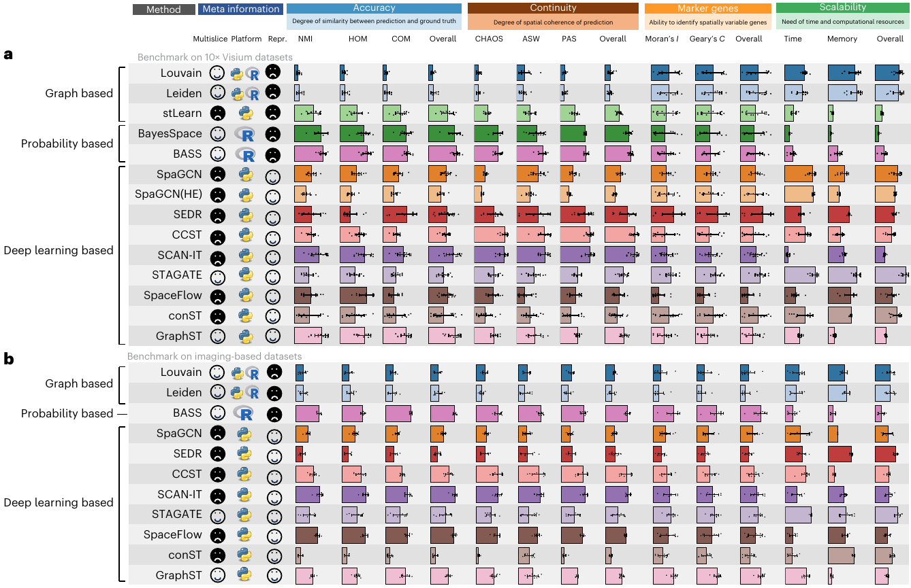

# Spatial Transcriptomics Clustering & Spatial Domain Identification

## From Low-Dimensional Manifolds to Spatial Domains

In upstream modules, we filtered technical artifacts (`SpotSweeper` and morphological QC gates), standardized sequencing depth via size-factor log-normalization (`scuttle::logNormCounts`), prioritized informative features (HVGs via `scran::modelGeneVarByPoisson()` and SVGs via Moran's $I$ and `nnSVG`), and compressed the expression matrix into low-dimensional embeddings (`PCA`, `PCA_banksy`, and `UMAP`).

The next analytical step groups spatial capture units (spots, 16-µm bins, or segmented cells) into _biologically meaningful communities_. This bridges intermediate dimensionality reduction and downstream biological interpretation, including cluster marker discovery, cell-type annotation, and differential spatial pattern analysis.

```text
================================================================================
                     SPATIAL TRANSCRIPTOMICS PIPELINE POSITION
================================================================================

[01–03 Data Struct.]  [04–09 QC & Norm]    [10–12 Intermediate]  [13 Clustering]
┌──────────────────┐  ┌─────────────────┐  ┌──────────────────┐  ┌─────────────┐
│ Raw Files/Images │  │ Filter Outliers │  │ HVGs & SVGs      │  │ Non-Spatial │
│ SCE / SPE / SFE  │─►│ Size-Factor Log │─►│ PCA & BANKSY PCA │─►│ Leiden      │
│ Matrix Objects   │  │ Feature Scaling │  │ UMAP Manifolds   │  │ Spatial     │
└──────────────────┘  └─────────────────┘  └──────────────────┘  │ Domains     │
                                                                 └──────┬──────┘
                                                                        │
                                                                        ▼
                                                                [14+ Downstream]
                                                                ┌──────────────┐
                                                                │ Marker DE    │
                                                                │ Cell Typing  │
                                                                │ Spatial Stats│
                                                                └──────────────┘
================================================================================
```

## Cell-Type Clustering vs. Spatial Domain Identification

In spatial transcriptomics, clustering addresses **two distinct biological and algorithmic goals** ([Heumos et al., _Nat Rev Genet_, 2023](https://doi.org/10.1038/s41576-023-00586-w)):

```text
=================================================================================
            TWO DISTINCT CLUSTERING GOALS IN SPATIAL TRANSCRIPTOMICS
=================================================================================

1. Cell-Type Clustering (Single-Cell State)    2. Spatial Domain Identification
┌──────────────────────────────────────────┐  ┌─────────────────────────────────┐
│ • Goal: Identify discrete cell types     │  │ • Goal: Delineate coherent      │
│   (e.g., T cells, Fibroblasts, Goblet)   │  │   tissue layers & niches (e.g., │
│ • Focus: Intrinsic transcriptomic state  │  │   Normal Mucosa, Tumor Core,    │
│ • Spatial Expectation: Cells of the same │  │   Desmoplastic Stroma, Margin)  │
│   type can be widely dispersed or        │  │ • Focus: Shared microenvironment│
│   intermingled across the whole tissue   │  │ • Spatial Expectation:          │
│                                          │  │   Contiguous compartments       │
└──────────────────────────────────────────┘  └─────────────────────────────────┘
=================================================================================
```

### Why Dissociated scRNA-seq Methods Fall Short

Standard scRNA-seq workflows construct a Shared Nearest Neighbor (SNN) graph in gene expression space (typically on the top 10–30 PCs), followed by modularity-based community detection (Louvain or Leiden):

* **Spatially Unaware:** Standard SNN graph construction ignores physical tissue coordinates $(x, y)$.
* **Technical Fragmentation vs. True Cellular Mosaicism:** Non-spatial clustering often produces fine-grained, intermingled cluster patterns across tissue sections. Part of this reflects technical artifacts—adjacent cells within the same histological layer split by capture dropouts, varying sequencing depth, or cell-cycle phase—while another part reflects **authentic biological heterogeneity**, such as diverse immune cells and fibroblasts infiltrating the colorectal adenocarcinoma invasive front. Because non-spatial clustering ignores $(x, y)$ coordinates, it cannot separate dropout-driven noise from true cell-type intermingling, nor can it aggregate multi-cellular mixtures into contiguous anatomical domains.
* **Failure to Model Microenvironments:** In intact tissues such as human colorectal adenocarcinoma (CRC), a cell's phenotype is shaped by neighboring cell–cell contacts, paracrine signaling, and extracellular matrix composition.

## Biological & Algorithmic Assumptions of Spatial Clustering

Spatially-aware clustering methods leverage explicit biological and topological priors:

1. **Local Spatial Autocorrelation:** Adjacent spatial spots or cells are more likely to share transcriptomic profiles and phenotypic states than distant ones.
2. **Multi-Cellular Domain Composition:** A histological domain (such as a colonic crypt, invasive tumor front, or reactive lymphoid aggregate) is a **multi-cellular collective** composed of several interacting cell types.
3. **Discontinuous Distant Recurrence:** Distinct anatomical regions can share the same functional identity despite being physically separated (e.g., bilateral cerebral hemispheres, dispersed submucosal blood vessels, or repetitive epithelial crypts). Algorithms must balance local spatial smoothing without artificially fusing unrelated structures or erasing distant recurrences.

## Taxonomy of Spatially-Aware Clustering Algorithms

Following the **Orchestrating Spatial Transcriptomics Analysis (OSTA)** classification ([Crowell et al., _bioRxiv_, 2025](https://doi.org/10.1101/2025.06.23.660674)), spatial clustering methods fall into three primary computational paradigms:

```text
┌───────────────────────────────────────────────────────────────────────┐
│ TAXONOMY OF SPATIAL CLUSTERING METHODS                                │
├───────────────────────────────────────────────────────────────────────┤
│ 1. Probabilistic & Random Field Models (Markov Random Fields):        │
│    • Hidden Markov Random Fields (HMRF / Giotto)                      │
│    • BayesSpace (Bayesian Potts Model with Subspot Resolution)        │
├───────────────────────────────────────────────────────────────────────┤
│ 2. Encoder-Based & Deep Graph Architectures (Graph Neural Networks):  │
│    • STAGATE (Spatial Transcriptomics Graph Attention Autoencoder)    │
│    • CellCharter (Spatial Microenvironment Autoencoders)              │
├───────────────────────────────────────────────────────────────────────┤
│ 3. Neighborhood-Augmented Feature Space Embeddings:                   │
│    • BANKSY (Dual Spatial Kernels + Fast Standard Graph Partitioning) │
└───────────────────────────────────────────────────────────────────────┘
```

### Probabilistic & Random Field Models

#### Hidden Markov Random Field (HMRF) in Giotto

The Hidden Markov Random Field (HMRF) model frames spatial domain detection as a **probabilistic trade-off** between a cell's intrinsic transcriptomic state and the extrinsic influence of its physical tissue microenvironment ([Zhu et al., _Nat Biotechnol_, 2018](https://doi.org/10.1038/nbt.4260); [Dries et al., _Genome Biol_, 2021](https://doi.org/10.1186/s13059-021-02286-2)).

The cluster state $C_i \in \{1, \dots, K\}$ of spot/cell $i$ is latent ("hidden") and inferred by maximizing the joint posterior probability combining two complementary forces:

$$
P(C_i \mid X_i, C_{\mathcal{N}(i)}) \propto \underbrace{P(X_i \mid C_i)}_{\substack{\text{\textbf{Intrinsic Factor}} \\ \text{(Expression Likelihood)}}} \times \underbrace{P(C_i \mid C_{\mathcal{N}(i)})}_{\substack{\text{\textbf{Extrinsic Factor}} \\ \text{(Spatial Prior / Potts Model)}}}
$$

$$
P(C_i \mid X_i, C_{\mathcal{N}(i)}) \propto P(X_i \mid C_i) \cdot \exp\left( \beta \sum_{j \in \mathcal{N}(i)} \mathbb{I}(C_i = C_j) \right)
$$

where:

* **$X_i$** is the normalized expression vector of spatial genes measured at spot $i$.
* **$P(X_i \mid C_i)$** is the **emission probability** (typically modeled as a multivariate Gaussian $\mathcal{N}(\mu_k, \Sigma_k)$), quantifying how well cell $i$'s observed expression matches the molecular signature of domain $k$.
* **$\mathcal{N}(i)$** is the set of physical neighbors connected to cell $i$ in an undirected spatial network (constructed via Delaunay triangulation or $k$-NN).
* **$\mathbb{I}(C_i = C_j)$** is an indicator function that equals $1$ if neighbor $j$ shares the same domain label as cell $i$, and $0$ otherwise.
* **$\beta \ge 0$** is the **spatial smoothness (interaction) parameter** governing neighbor coupling strength:
  * $\beta = 0$: Disables spatial influence entirely, reducing HMRF to non-spatial Gaussian Mixture / $k$-means clustering.
  * **Moderate $\beta$**: Enforces local domain cohesion, suppressing dropouts and isolated classification noise to yield clean, contiguous anatomical layers (e.g., cortical layers L1–L6).
  * **Excessive $\beta$**: Over-smooths the tissue, artificially fusing biologically distinct adjacent layers into a single domain.

```text
===================================================================================
                       HIDDEN MARKOV RANDOM FIELD (HMRF) LOGIC
===================================================================================

1. Spatial Neighborhood Graph (N_i)    2. Joint Posterior Inference
         (Domain 1)                       P(C_i | X_i, C_{N_i}) ∝
              \                           P(X_i | C_i)  ×  exp( β · ∑ I(C_i = C_j))
               \                          ────────────     ────────────────────────
 (Domain 2) ── [ ? ] ── (Domain 1)         Intrinsic               Extrinsic
               /  C_i                      Expression            Spatial Prior
              /                            Likelihood         (Neighbor Agreement)
         (Domain 1)
                                       Result: Prevents "salt-and-pepper" noise;
                                          delineates sharp, continuous domains
===================================================================================
```

* **Practical Implementation in Giotto:**
  1. `doHMRF()`: Fits the model across multiple candidate $K$ values (number of spatial domains) and a range of $\beta$ parameters on pre-selected SVGs.
  2. `viewHMRF()`: Plots the trade-off curve between expression likelihood and spatial energy to select an optimal $\beta$ (identifying the "elbow" where spatial coherence is gained without excessively compromising expression fit).
  3. `addHMRF()`: Annotates the selected optimal domain assignments back into the object metadata for downstream marker analysis.

#### BayesSpace

**BayesSpace** ([Zhao et al., _Nat Biotechnol_, 2021](https://doi.org/10.1038/s41587-021-00935-2)) is a fully Bayesian hierarchical framework tailored for _lattice-structured_ spatial transcriptomics data (e.g., 10x Visium hexagonal arrays, Visium HD square grids, and legacy ST).

Unlike HMRF, which directly models gene expression vectors, BayesSpace models a low-dimensional representation (typically the top 15 principal components) using a heavy-tailed error structure and Markov Chain Monte Carlo (MCMC) sampling.

```text
┌───────────────────────────────────────────────────────────────────────┐
│                BAYESSPACE HIERARCHICAL MODEL ARCHITECTURE             │
├───────────────────────────────────────────────────────────────────────┤
│  1. Spot-Level Expression Likelihood (Heavy-Tailed Student's t via    │
│     Gaussian Scale Mixture) (y_i | z_i = k, w_i) ~ N(μ_k, w_i · Λ^-1) │
│     where w_i ~ Inv-Gamma(ν/2, ν/2) with ν = 4                        │
│     ──► Robust against technical outliers                             │
├───────────────────────────────────────────────────────────────────────┤
│  2. Spatial Prior (Modified Potts Model on Array Lattice)             │
│     P(z_i = k | z_N(i)) ∝ exp( γ · ∑_{j ∈ N(i)} I(z_i = z_j) )        │
│     where γ > 0 encourages physical neighbors (6 for Visium,          │
│     4 for Visium HD) to share cluster labels                          │
├───────────────────────────────────────────────────────────────────────┤
│  3. Subspot Resolution Enhancement (Latent Deconvolution)             │
│     Physical Spot (55 µm)                                             │
│     ──► Subdivided into 6 subspots (Visium) or 9 (ST)                 │
│     Latent subspot expression y*_ij jittered around y_i subject to    │
│     ∑_j y*_ij = y_i                                                   │
│     Optional: Map subspot PCs back to expression space via XGBoost    │
└───────────────────────────────────────────────────────────────────────┘
```

##### Mathematical Formulation & Model Components

1. **Low-Dimensional Input ($y_i$):**
   * Input expression is projected into $d$-dimensional PC space ($d = 15$ by default, computed on the top 1,000–2,000 HVGs).
   * Modeling in PC space dramatically accelerates MCMC convergence and eliminates the need for manual marker gene pre-selection.
2. **Outlier-Robust Likelihood (Student's $t$ Error Model):**
   * For spot $i$ belonging to latent cluster $z_i = k$, the PC vector $y_i$ is modeled as a multivariate Gaussian conditional on an observation-specific weight $w_i$:
     $$(y_i \mid z_i = k, w_i) \sim \mathcal{N}\left(\mu_k, w_i \mathbf{\Lambda}^{-1}\right)$$
     where $\mu_k$ is the cluster mean vector, $\mathbf{\Lambda}$ is the cluster precision matrix, and $w_i \sim \text{Inv-Gamma}(\nu/2, \nu/2)$ with degrees of freedom fixed at $\nu = 4$.
   * **Robustness:** Marginalizing over $w_i$ yields a multivariate Student's $t$-distribution. Spots with high technical noise or capture artifacts receive small weights ($w_i$), preventing them from distorting cluster centroids $\mu_k$.
3. **Spatial Prior (Potts Lattice Model):**
   * Physical array adjacencies define neighborhood $\mathcal{N}(i)$ (6 immediate neighbors on Visium's hexagonal lattice; 4 on Visium HD's square grid).
   * The conditional prior probability for cluster assignment $z_i$ follows an energy-based Potts model:
     $$P(z_i = k \mid z_{\mathcal{N}(i)}) \propto \exp\left( \gamma \sum_{j \in \mathcal{N}(i)} \mathbb{I}(z_i = z_j) \right)$$
     where $\gamma \ge 0$ is the smoothing parameter (typically $\gamma = 2$ or $3$).
4. **Subspot Resolution Enhancement:**
   * BayesSpace can subdivide each physical 55 µm Visium spot into **6 micro-subspots** (or 9 for ST).
   * Unobserved subspot expression $y^*_{ij}$ is treated as a latent variable constrained such that the average subspot expression sums to the observed spot expression: $\sum_{j} y^*_{ij} = y_i$.
   * An **XGBoost** regression model trained on spot-level PCs predicts gene-level expression profiles from subspot PCs, achieving near-single-cell resolution without requiring matched scRNA-seq references.

##### Practical Execution Workflow in R/Bioconductor

In Bioconductor pipelines (`SpatialExperiment`), BayesSpace follows a clean 4-step workflow:

1. **`spatialPreprocess(spe, n.PCs = 15, n.HVGs = 2000, log.normalize = TRUE)`:**
   * Calculates size factors, log-normalizes counts, identifies HVGs, and extracts top PCs into `reducedDim(spe, "PCA")`.
2. **`qTune(spe, qs = 3:10, platform = "Visium", nrep = 1000)`:**
   * Runs MCMC across candidate cluster numbers ($q \in [3, 10]$) and computes pseudo-log-likelihood curves to assist in identifying the optimal $q$ via the elbow criterion (`qPlot()`).
3. **`spatialCluster(spe, q = k, platform = "Visium", d = 15, nrep = 50000, burn.in = 1000)`:**
   * Initializes cluster labels $z$ using non-spatial `mclust` on top PCs.
   * Runs Gibbs sampling (for $\mu_k, \mathbf{\Lambda}, w_i$) and Metropolis-Hastings updates (for $z_i$), storing final domain assignments in `colData(spe)$spatial.cluster`.
4. **`spatialEnhance(spe, q = k, platform = "Visium", d = 15, nrep = 100000)` (Optional):**
   * Enhances resolution to subspot units, returning a new higher-resolution `SpatialExperiment` object with expanded spot coordinates and subspot cluster labels.

### Encoder-Based & Deep Graph Architectures

#### STAGATE

**STAGATE** ([Dong & Zhang, _Nat Commun_, 2022](https://doi.org/10.1038/s41467-022-29439-6)) implements a **Graph Attention Autoencoder** to learn joint spatio-transcriptomic embeddings. Edge weights in the spatial neighbor graph are adaptively learned via attention mechanisms, smoothing expression within continuous histological layers while preventing blurring across sharp anatomical boundaries. Some graph neural network extensions also integrate H&E histology image features directly into the latent representation.

#### CellCharter

**CellCharter** ([Varrone et al., _Nat Genet_, 2024](https://doi.org/10.1038/s41588-023-01588-4)) identifies **cellular niches and microenvironments** in single-cell resolution spatial data. It aggregates cell-type or feature compositions across multiple neighborhood topological radii, compresses spatial interaction vectors through an autoencoder, and partitions the latent manifold via a Gaussian Mixture Model (GMM).

### Neighborhood-Augmented Feature Space: BANKSY

In the previous processing step, we utilized **BANKSY** ([Singhal et al., _Nat Genet_, 2024](https://doi.org/10.1038/s41588-024-01664-3)) as a _spatially-aware dimensionality reduction_ strategy to generate neighbor-augmented principal components (`PCA_banksy`).

What changes for clustering is how we partition and biologically interpret this latent space. While dedicated spatial clustering algorithms like BayesSpace and HMRF enforce spatial contiguity _during_ cluster assignment via iterative probabilistic priors (Potts models / MRFs), **BANKSY solves the spatial problem entirely upstream in feature space**. By clustering the `PCA_banksy` embedding using standard SNN graph partitioning (Leiden or Louvain), spatial smoothing and domain coherence emerge naturally without computational overhead.

* **Dual Spatial Kernels:** Combines a cell's own expression with:
  1. The weighted neighborhood mean $\bar{\mathbf{x}}_i = \sum_{j \in \mathcal{N}(i)} W_{ij} \mathbf{x}_j$ (microenvironmental texture).
  2. The Azimuthal Gabor Filter (AGF) (directional gene expression gradients across cell borders).
* **The Operational Lever: Toggling Between Two Biological Tasks via $\lambda$:**
  * $\lambda = 0$ (Non-Spatial Baseline): **Standard scRNA-seq PCA**; ignores coordinates entirely.
  * $\lambda \approx 0.2$ (Cell-Type Clustering Mode): Neighbors act purely as a denoising filter to rescue dropouts, while cell-autonomous identity dominates. Partitions cells into **fine-grained cell types** with sharp boundaries.
  * $\lambda \ge 0.7$ (e.g., $\lambda = 0.8$ in Visium HD & Xenium workflows; Spatial Domain Mode): Microenvironmental context dominates. Clusters represent **multi-cellular tissue niches and anatomical layers** (e.g., mucosal crypts, tumor cores, or cortical layers) rather than isolated cell types.
* **Algorithmic Advantage in Downstream Clustering:** Because the spatial smoothing is baked into the PCA coordinates, community detection scales linearly $O(n)$ via fast graph modularity algorithms—bypassing the heavy MCMC sampling required by BayesSpace while matching or exceeding its domain classification accuracy (ARI).

## Comprehensive Method Benchmark & Trade-Off Matrix

| Method | Paradigm | Input Data | Spatial Information Used | Subspot Capability | Computational Speed | Primary Strength |
| :--- | :--- | :--- | :--- | :---: | :---: | :--- |
| **Non-Spatial Leiden / Louvain** | Graph Partitioning | `PCA` on `logcounts` | None (expression only) | No | **Ultra-Fast** | Unbiased discovery of global cell types without spatial smoothing. |
| **BayesSpace** | Bayesian Potts Model | Top 10–15 PCs (`PCA`) | Physical lattice adjacencies | **Yes** | Moderate (MCMC runtime) | Continuous domain smoothing and subspot resolution on grid arrays. |
| **HMRF (Giotto)** | Markov Random Field | Normalized counts / PCs | Delaunay / $k$-NN spatial graph | No | Moderate | Probabilistic modeling of multi-cellular tissue domains. |
| **BANKSY** | Augmented Feature Space | `PCA_banksy` (counts + neighbor kernels) | $k$-NN or Delaunay graph | No | **Ultra-Fast** | Unifies cell typing (λ ≈ 0.2) and domain segmentation (λ ≥ 0.7). |
| **STAGATE** | Graph Attention Network | Gene expression matrix (+ optional H&E) | Spatial proximity graph | No | GPU-dependent | Resolves convoluted borders using learned attention weights. |
| **CellCharter** | Autoencoder + GMM | Cell-type labels / features | Multi-scale neighborhood graphs | No | Fast–Moderate | Multi-scale microenvironment and niche boundary detection. |

## Evaluating Cluster Quality & Spatial Coherence

Unlike dissociated scRNA-seq where cluster evaluation relies solely on transcriptomic separation, spatial clustering requires evaluating **four complementary dimensions**: ground-truth accuracy (when labels exist), unsupervised spatial continuity, marker gene spatial autocorrelation, and computational scalability ([Yuan et al., _Nat Methods_, 2024](https://doi.org/10.1038/s41592-024-02215-8)).

### Supervised Accuracy (When Ground Truth Exists)

When expert manual annotations are available—such as pathologist-annotated cortical layers in the LIBD human dorsolateral prefrontal cortex (DLPFC) dataset ([Maynard et al., _Nat Neurosci_, 2021](https://doi.org/10.1038/s41593-020-00787-0))—agreement with ground truth is quantified using label-concordance metrics:

* **Normalized Mutual Information (`NMI`), Homogeneity (`HOM`), and Completeness (`COM`):** Measure how much mutual information predicted clusters share with reference histological layers, and whether each cluster maps cleanly to a single domain.
* **Adjusted Rand Index (`ARI`):** Evaluates pairwise label agreement corrected for chance ($\text{ARI} \in [-1, 1]$).

### Unsupervised Spatial Continuity & Marker Coherence

In discovery datasets lacking manual annotations (such as our CRC P2 sections), cluster quality is assessed directly from spatial neighborhood topology and marker expression:

* **Spatial Continuity (`CHAOS`, `ASW`, `PAS`):** `CHAOS` measures spatial compactness via intra-cluster graph edge lengths; `ASW` (Average Silhouette Width) captures cluster separation; and `PAS` (Percentage of Abnormal Spots) flags spots whose label disagrees with their physical neighbors. In Bioconductor workflows, **Spatial Neighbor Purity** (`bluster::neighborPurity`) and the **Concordex Index** provide analogous neighborhood-purity diagnostics.
* **Marker Gene Spatial Autocorrelation (`Moran's I`, `Geary's C`):** Evaluates whether genes differentially expressed between predicted clusters form coherent spatial patterns rather than random noise.

### Systematic Benchmark & Scalability Trade-Offs

Across 34 benchmark datasets (12 10x Visium and 22 imaging-based), spatially-aware methods consistently outperform non-spatial graph baselines (`Louvain`, `Leiden`) in domain accuracy and spatial continuity, though often at higher runtime and peak memory cost:



_Figure: Rank-based benchmarking of spatial clustering methods across 10x Visium (a, $N = 12$ datasets) and imaging-based platforms (b, $N = 22$ datasets), summarizing multislice support, R/Python platform, latent representation output (`repr.`), clustering and spatial coherence metrics (NMI, HOM, COM, CHAOS, ASW, PAS, Moran's $I$, Geary's $C$), runtime, and peak memory (mean ± 95% CI; adapted from Yuan et al., _Nat Methods_, 2024)._

### Current Challenges & Limitations

* **Benchmark Overfitting:** Most spatial clustering methods have been heavily tuned and benchmarked on a small set of tissues—predominantly human DLPFC—creating a risk of overfitting to regular, layered brain architectures rather than irregular tumor microenvironments such as CRC.
* **Scalability Bottlenecks:** Many probabilistic and deep-learning methods were developed for classic Visium slides (≈ 3,000–5,000 spots) and face substantial memory or runtime bottlenecks when scaled to Visium HD or Xenium datasets containing 30,000–100,000+ segmented cells.

## Downstream Biological Discovery: Linking Clusters to Marker Genes

Once clusters or spatial domains are established, functional characterization identifies the genes driving each compartment:

```text
=============================================================================
                FROM SPATIAL DOMAINS TO BIOLOGICAL DISCOVERY
=============================================================================

Spatial Domain Clusters   Statistical Marker Testing     Biological Output
┌─────────────────────┐  ┌─────────────────────────┐  ┌─────────────────────┐
│•Normal Mucosa Crypts│  │•scran::findMarkers()    │  │•Domain Marker Genes │
│•Invasive Tumor Core │─►│•DESpace (NB GLM on bins)│─►│•Cell-Type Signatures│
│•Desmoplastic Stroma │  │•Seurat::FindAllMarkers()│  │•Niche Pathways      │
└─────────────────────┘  └─────────────────────────┘  └─────────────────────┘
=============================================================================
```

* **Cluster Marker Testing (`scran::findMarkers()`):** Performs pairwise differential expression across clusters on `logcounts` to identify specific markers characterizing each cell type or tissue domain.
* **`DESpace` Framework ([Cai, Robinson & Tiberi, _Bioinformatics_, 2024](https://doi.org/10.1093/bioinformatics/btae027)):** Models spot or bin counts using a negative binomial generalized linear model conditioned on spatial domain labels, testing for both global spatial variability and domain-specific marker SVGs while controlling the false discovery rate (FDR).

## Practical Implementation Roadmap

In the upcoming clustering and marker-discovery notebooks, we implement and contrast non-spatial and spatially-aware clustering across our Visium HD and Xenium CRC objects:

```text
===============================================================================
                    CLUSTERING JUPYTER NOTEBOOK ROADMAP
===============================================================================
Step 1: Baseline Non-Spatial Clustering
├── Build Jaccard SNN graph on top 10 PCA components (bluster::makeSNNGraph)
├── Run Leiden community detection (igraph::cluster_leiden)
└── Project clusters onto tissue coordinates to distinguish true cellular mosaicism from dropout fragmentation

Step 2: Feature-Augmented Spatial Clustering (BANKSY)
├── Build Jaccard SNN graph on PCA_banksy (scran::buildSNNGraph)
├── Run Leiden clustering across λ = 0.2 (cell typing) vs. λ = 0.8 (domains)
└── Compare spatial coherence and per-cluster isolation against Step 1

Step 3: Probabilistic Spatial Clustering on Binned Grids (BayesSpace)
├── Configure spatial lattice structure on Visium HD 16-µm binned spe
├── Run BayesSpace::spatialPreprocess(skip.PCA = TRUE) and spatialCluster()
└── Contrast MCMC Potts-model domains against BANKSY-Leiden domains

Step 4: Spatial Quality Evaluation & Marker Discovery
├── Quantify spatial compactness (neighbor purity) and cluster concordance
├── Identify cluster-defining marker genes via scran::findMarkers() and DESpace
└── Serialize clustered objects for downstream cell-type annotation
===============================================================================
```
